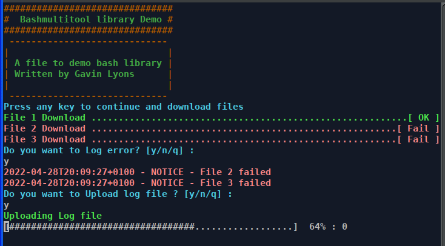
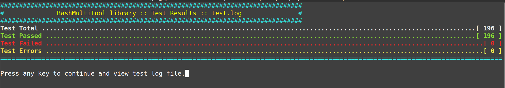

# BashMultiTool

[](https://www.paypal.com/paypalme/whitelight976) [](https://github.com/gavinlyonsrepo/bashmultitool/actions/workflows/shellcheck.yml)

## Overview

* Name: bashMultiTool
* Description:

A Bash Shell library file for commonly used functions
can be imported into shell scripts to create functional and colorful
scripts and Terminal users interfaces(TUI).
The library allows user to redefine commonly used functions every time you write a shell script, the library may save a part of the development time.

* Author: Gavin Lyons
* GNU bash: version 5.2.21

## Table of contents

* [Installation](#installation)
* [Usage](#usage)
* [Software](#software)
* [Example](#example)
* [Test](#test)

## Installation

### Arch based System

Package available in the Arch Linux user repo AUR

### For other linux systems

Download latest fixed release and run the makefile as per
terminal commands below for version 2.2.0 latest release at time of writing
Note: If you install with this method you will not be informed of updates
by system.

```sh
curl -sL https://github.com/gavinlyonsrepo/bashmultitool/archive/2.2.0.tar.gz | tar xz
cd  bashmultitool-2.2.0
sudo make install
```

## Usage

Source the library functions from your bash shell scripts like so:

```sh
LIBPATH="/usr/lib/bashmultitool/"
for MYFILE in "$LIBPATH"*;
do
    source "$MYFILE"
done
```

To access library functions from your shell scripts type:

```sh
# [function-name] [keyword] [options]
# eg

bmtPrintFunc b_red "Hello World"
 ```

## Software

Nine separate markdown help files with detailed information,
in documentation folder are available
For shortcut to each help file click on link in 2nd table below.
A script to print library meta data is also installed.

| Installed File Path | Description |
| ------ | ------ |
| /usr/bin/bashmultitool | Script to print library meta data |
| /usr/lib/bashmultitool/bashmultitool/* | 9 library files see next table |
| /usr/lib/bashmultitool/doc/README.md | readme |
| /usr/lib/bashmultitool/doc/bmt*.md | 9 Documentation files see next table |

| Library file | Function | Sections | Content | Doc link |
| ---- | ---- | ---- | ---- | ---- |
| bmtPrint | bmtPrintFunc | 101 | Printing text | [bmtPrint help file](documentation/bmtPrint.md) |
| bmtPrompt | bmtPromptFunc | 201-210 | Prompts | [bmtPrompt help file](documentation/bmtPrompt.md) |
| bmtNetwork | bmtNetworkFunc | 301-310 | Network related | [bmtNetwork help file](documentation/bmtNetwork.md) |
| bmtLinux | bmtLinuxFunc | 401-410 | Linux related | [bmtLinux help file](documentation/bmtLinux.md) |
| bmtFiles | bmtFilesFunc | 501-510 | File related | [bmtFiles help file](documentation/bmtFiles.md) |
| bmtData | btmDataFunc | 601-610 | Data related | [bmtData help file](documentation/bmtData.md) |
| bmtTime | btmTimeFunc | 701-710 | Time related | [bmtTime help file](documentation/bmtTime.md) |
| bmtMisc | bmtMiscFunc | 801-802 | Miscellaneous | [bmtMisc help file](documentation/bmtMisc.md) |
| bmtTest | bmtDrawFunc | 901-907 | Draw related | [bmtDraw help file](documentation/bmtDraw.md) |
| bmtTest | bmtTestFunc | 1001 | internal library test | [bmtTest help file](documentation/bmtTest.md) |

The library contains eight section's, Each section has one file with one function.
Which contains 70 sub-sections in total.
The sections are grouped per logical function.
Printing, prompting, Linux related, file related,
data related, time related , draw related, network related and miscellaneous.
The sections are mostly independent of each other
you can source them individually if you wish, however the prompt file *is*
dependent on print. There is also a  test section bmtTest used to test library.

## Example

Output of basic example file in example folder, showing basic usage.



## Test

The library contains a test section bmtTest used to test library.
The test section contains one function bmtTestFunc which is used to test the library.
The test function is used in the test file "testTest.sh", which runs an semi-automated test on entire library and produces a report. Pass the test file a number between 1-9 , 1-9 correspond to the sections, 0 will test entire library.
The repo also contains a *test folder* where a test file used in development are available, one function for each library file.

```sh
# testTest.sh [section number]
testTest.sh 0
```

Output report of test script testTest.sh.


